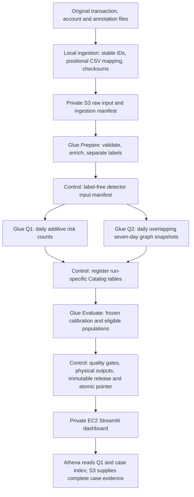

# Run and understand the full AML pipeline

This guide describes the maintained implementation and the separately authorised
30 October 2026 fresh run. Consult the
[session handoff](team-handoffs/2026-10-30-kelvin-full-pipeline.md) for its actual
outcome. Commands in this guide do not establish that a stage succeeded. A completed
run identity must never be reused, and the old revoked attempt stays revoked.

## What runs where



Step Functions starts and waits for Glue jobs; it does not process the transaction
rows itself. Spark processing runs on Glue-managed workers. EC2 hosts the
visualization, and Athena queries the published Parquet data. This is an on-demand
batch pipeline. No daily schedule or incremental-ingestion service is installed.

## 1. Ingestion and source identity

The three source files are `HI-Medium_Trans.csv`, `HI-Medium_accounts.csv` and
`HI-Medium_Patterns.txt`. Original files are preserved. The ingestion helper scans
the entire transaction file because its records are not chronologically sorted.
It gives every transaction a source ID consisting of the original transaction-file
SHA256 and its original 1-based CSV data-record ordinal. Two identical-looking
records remain distinct.

The raw transaction CSV repeats the header `Account`. The importer reads fields
by position into separate sender and receiver fields. Full ingestion covers
`[2022-09-01, 2022-09-29)` in dataset-local time; the source timezone is unspecified.
The ingestion manifest records source hashes, artifact hashes, counts, daily scope
and independently accumulated format totals.

The stable-ID ingestion artifacts are `transactions.csv.gz`, `accounts.csv.gz`,
`ingestion-quarantine.jsonl.gz` and `manifest.json`. A new run may re-upload the
verified complete ingestion copy: the record IDs refer to the originals, not the
upload time. Upload checks every part on S3 and the whole local artifact hash,
then conditionally completes the upload rather than overwriting an existing key.

For this fresh run the artifacts are staged under a new raw namespace. The source
annotations remain separately restricted for evaluation. They are never detector
inputs.

## 2. Preparation

The Prepare job reads the ingestion manifest and staged CSVs. It validates record
IDs, exact decimal money, currencies, minute timestamps and original-file record
accounting. Bank IDs are normalized while raw identifiers remain available.
Accounts are enriched using **bank ID and account number together** for both
endpoints. Unknown enrichment must not drop a transaction or multiply records.

It writes label-free transaction facts under `curated/`, labels under the separate
`references/labels/` tree, quarantines under `quarantine/preparation/`, and a
preparation quality report under `quality/preparation/`. Outputs carry the dataset
and run identities. A successful full preparation must reconcile all source rows,
not merely output a non-empty folder. Money uses `decimal(38,8)`; paid and received
currencies stay separate.

## 3. The two analysis branches

A Control invocation first creates a detector input manifest from the passed
preparation report. Q1 and Q2 then run in parallel.

**Q1, monitoring allocation:** the Risk job reads facts and historical labels. Its
base grain includes event date, sender bank, receiver bank, payment format, paid
currency and received currency. It stores additive transaction count N and labelled
count L plus per-currency amounts. The dashboard filters a consistent population,
sums N and L across dates, and then derives rates and lift. It never averages daily
rates or sums money across currencies. Small segments remain inspectable but are
not ranked as strongly supported evidence.

**Q2, connected cases:** the Detect job reads only the label-free allowlisted
manifest/facts. Its role explicitly denies raw data, labels/annotations, Q1 risk
outputs and evaluation outputs. It does not use Q1's label-derived rankings.

For each daily cutoff it considers the preceding seven days, excluding future
transactions. This produces overlapping snapshots rather than independent minute
batches. It detects fan-in and fan-out with five distinct non-self counterparties,
and bounded directed cycles of two to four accounts using degree-eligible joins.
The frozen cycle degree threshold is 64. Capacity guards stop an oversized run
instead of silently truncating it. Self-transfers remain stored but are excluded
from motif edges. These are structural investigation leads, not proof of laundering
or chronological return of identical money.

Cases carry stable IDs, rule/window/cutoff, account/entity participants and core
source evidence IDs. Large evidence is stored in complete sharded bundles; the
bounded dashboard graph is only a display view. The 28 daily snapshot outputs
include their declared coverage and exclusions.

## 4. Catalog, evaluation and publication

After both analysis branches pass, Control registers run-specific external Q1/Q2
Parquet tables and their date partitions in `is459_aml_full`. New table names
include the run ID; an old table is not overwritten to point at different data.

The Evaluate job then uses a separate role to read facts, labels, annotations and
Q2 results. Development/calibration is 1–8 September, holdout is 9–16 September,
and sparse-tail reporting is 17–28 September. Settings stay frozen before holdout.
Evaluation uses the declared eligible population, not only detected transactions,
and reports transaction precision/recall and eligible annotation recovery against
separate baselines. Incomplete annotations are not exhaustive truth for all cases.

The final Control invocation requires all four quality reports to say `PASSED`,
matching dataset/run/analysis identities and reconciled populations. It verifies
physical Parquet output populations, Catalog locations, evaluator artifact hashes
and frozen calibration. It writes an immutable release manifest first and updates
`published/current.json` last using the expected previous pointer ETag. A failed
stage never publishes a partial release or replaces the previous successful one.

One complete processing execution is:

```text
Prepare → MakeManifest → [Risk || Detect] → Catalog → Evaluate → Publish
```

The same small Control Glue job runs three times with different `--phase` values.
A `.sync` Step Functions task waits for each Glue run. There are no automatic retries
or recurring schedules. A failed execution requires diagnosis; restarting it with
the same output identity is unsafe.

## 5. Visualization on EC2

Only after the workflow succeeds and the new publication is verified, a temporary
CloudFormation stack creates an Amazon Linux EC2 `t3.small` instance. Its user-data
installs the dashboard dependencies, downloads the frozen dashboard package and
starts Streamlit as a systemd service bound to `127.0.0.1:8501` on the instance.

The security group has **no inbound ports**. Access uses Systems Manager port
forwarding; a public browser URL or SSH opening is not required. The instance
uses an IAM role, never laptop keys. It can read published metadata, Q1 outputs,
Q2 case/evidence and evaluation metrics, plus use the bounded dashboard Athena
workgroup. It is denied raw facts/labels. Athena results go to a dedicated S3
prefix and are subject to the workgroup scan limit.

The app loads and verifies the publication once per refresh, then pins all queries
and downloads to it. It shows Monitoring, Connected cases, Evaluation & coverage,
and Release & provenance. Its charts use actual output tables; no offline prototype
fixtures are substituted. Refresh failure retains the previously loaded release.

The instance has an encrypted root disk with deletion on termination and a one-hour
termination guard. The stack should be deleted after the viewing session; an
instance shutting down by itself does not prove the stack/security group/profile
have been cleaned up. Any extension or later deployment needs its own scope.

## 6. Operator prerequisites

Use your own authorised profile, with `us-east-1` configured. Verify the expected
project account with the repository guard before cloud commands:

```bash
bash Implementation/scripts/check_aws_profile.sh YOUR_PROJECT_PROFILE
```

Use explicit `--profile` and `--region us-east-1` in AWS CLI commands. Do not fall
back to `default`. The local Python environment needs boto3/botocore; processing
checks additionally need the documented Spark environment. SSM forwarding needs
the official Session Manager plugin. Follow [SETUP.md](SETUP.md) and request
installation/configuration permission before changing a teammate's machine.

Before a run: fetch current GitHub changes, inspect open PRs and handoffs, coordinate
shared job/output ownership, record a new private approval/estimate, publish a
PLANNED handoff and draft PR, then mark IN_PROGRESS. The ceiling is not a hard
billing cap. Never launch from a historical approval or reuse an old plan file.

## 7. Commands for the newly authorised attempt

`deployment/full-maintained-stack.json` now mirrors the successfully deployed
configuration in `run30-stack.json`; earlier stack templates are historical.

These show the phases used by the dated driver. `PRIVATE_PLAN` means the path to
the operator's ignored, approved plan for this exact new attempt. Set it in your
shell along with `PROJECT_PROFILE`. Do not paste credentials into either variable
or into chat. The plan contains an explicit new run identity, code version, template
hash, previous publication pointer, estimate/reserves and `approved: true`.
Its approval must come from the human; the file is not self-authorisation.

First generate templates and run local guard checks:

```bash
python Implementation/deployment/build_run30.py
PYTHONPATH=Implementation:Implementation/tests python -m unittest test_run30_definition test_rerun_definition -q
```

For an original-source rebuild of the ingestion copy, use the existing helper with
your actual source paths and a **new** output directory:

```bash
python Implementation/scripts/build_development_input.py \
  --transactions /path/to/HI-Medium_Trans.csv \
  --accounts /path/to/HI-Medium_accounts.csv \
  --patterns /path/to/HI-Medium_Patterns.txt \
  --start 2022-09-01 --end 2022-09-29 --output /path/to/new-full-ingestion
```

Then upload the complete ingestion copy into the configured new raw namespace,
using an ignored location for the detailed observation:

```bash
python Implementation/deployment/upload_input.py --profile "$PROJECT_PROFILE" \
  --input /path/to/verified-full-ingestion --prefix raw/full-20261030-v1 \
  --record /path/to/private/ingestion-upload.json
```

Upload/verify immutable software, prepare and inspect the change set, then apply it:

```bash
python Implementation/deployment/run30.py --profile "$PROJECT_PROFILE" --plan "$PRIVATE_PLAN" --phase upload
python Implementation/deployment/run30.py --profile "$PROJECT_PROFILE" --plan "$PRIVATE_PLAN" --phase create
aws cloudformation describe-change-set --stack-name is459-aml-full-v1 \
  --change-set-name full-run30 --profile "$PROJECT_PROFILE" --region us-east-1
python Implementation/deployment/run30.py --profile "$PROJECT_PROFILE" --plan "$PRIVATE_PLAN" --phase apply
```

Wait for stack `UPDATE_COMPLETE`. Apply refuses resource additions/removals,
replacements, unexpected resource modifications, active jobs or an active workflow.
No processing runs during these deployment phases. Verify exact deployed templates,
job settings, trust/grants and workflow, then start **once**:

```bash
python Implementation/deployment/run30.py --profile "$PROJECT_PROFILE" --plan "$PRIVATE_PLAN" --phase verify
python Implementation/deployment/run30.py --profile "$PROJECT_PROFILE" --plan "$PRIVATE_PLAN" --phase start
python Implementation/deployment/run30.py --profile "$PROJECT_PROFILE" --plan "$PRIVATE_PLAN" --phase status
```

Repeat `status`, not `start`, while waiting. Request/start markers deliberately
prevent a repeated start. If a start request times out, inspect the saved execution
name/ARN and AWS history instead of retrying. Status records compute estimates and
requests a stop if the reserve approaches the ceiling; verify terminal state.
If a stage fails, preserve the errors and successful artifacts; do not tune against
holdout or blindly rerun the chain. `--phase stop` requests scoped workflow/job stops.

After workflow `SUCCEEDED`, independently verify the current manifest/reports and
start the EC2 visualization:

```bash
python Implementation/deployment/run30.py --profile "$PROJECT_PROFILE" --plan "$PRIVATE_PLAN" --phase dashboard
python Implementation/deployment/run30.py --profile "$PROJECT_PROFILE" --plan "$PRIVATE_PLAN" --phase dashboard-status
```

Wait for stack `CREATE_COMPLETE` and SSM agent `Online`. Get the instance ID from
the stack outputs, then open a tunnel:

```bash
aws ssm start-session --target YOUR_INSTANCE_ID \
  --document-name AWS-StartPortForwardingSession \
  --parameters '{"portNumber":["8501"],"localPortNumber":["8502"]}' \
  --profile "$PROJECT_PROFILE" --region us-east-1
```

Open `http://127.0.0.1:8502/` while the tunnel is running. Verify the displayed release
and actual Monitoring/Cases/Evaluation data; a health endpoint alone is insufficient.
When finished, close the tunnel and delete the temporary dashboard stack:

```bash
python Implementation/deployment/run30.py --profile "$PROJECT_PROFILE" --plan "$PRIVATE_PLAN" --phase remove-dashboard
```

Verify stack deletion, instance termination and root-volume deletion. The processing
stack can stay as idle definitions; no Glue compute runs merely because jobs exist.

## 8. Old-output deletion and future runs

For the current request, delete only objects in the private pre-run generated-output
inventory, after the new publication and EC2 visualization pass. Exclude raw source,
annotations, software and all new-run outputs. Each deletion must match the
inventoried ETag; a changed object is a conflict, not permission to delete a newer
owner's output. Verify the old objects are absent and the new release still loads.
Remove old run-specific Catalog tables only after checking their locations against
the deleted namespaces and preserving the new tables. Do not delete shared databases
or the bucket. After this cleanup, the older reports/manifests no longer have live
S3 outputs; historical handoffs describe past observations, not replayable datasets.

A future run needs a **new** run ID, raw input prefix, change-set identity, private
plan and marker directory. Update/review the dated builder/driver (including their
fixed template/stack names where relevant), regenerate templates, test, coordinate
and publish before execution. Reuse unchanged frozen software, or create a new
immutable package if code changes. Never delete private markers or change the run
identity inside a consumed plan to defeat the guards.

At session end, publish the sanitised observed outcome and update status/runbook.
Keep exact run/input/output identities, raw logs, inventories, cost records and
private plans ignored. A successful source push is not a successful cloud run; both
must be verified separately.

## Observed completion for this attempt

The fresh processing execution SUCCEEDED across all stages. Independent readback
verified the published manifest, four PASSED reports, reconciled populations and
Catalog locations. The EC2 visualization subsequently passed health and actual browser checks of
Monitoring, Cases, complete evidence preparation and Evaluation on the new release.
Superseded generated S3 objects and four proven-stale Catalog tables were removed
and verified absent; new data/raw inputs/annotations/software remain. The temporary
EC2 viewing window remains live under its verified shutdown guard; final teardown
is tracked separately in the session handoff. The command examples above describe a consumed run identity, not
authorisation to start it again.
