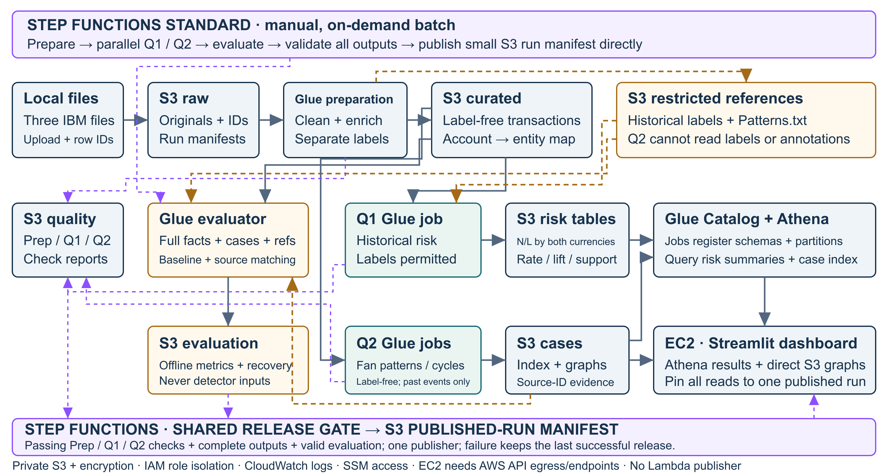

# IS459 Project Proposal

**AML Monitoring Allocation and Connected-Account Investigation**

**Dataset:** IBM Transactions for Anti-Money Laundering, HI-Medium.

**Status:** Business Questions 1 and 2 are confirmed. This is the requirements and target-design reference; architecture, thresholds and performance targets are not proof of implementation or measured performance. A limited prototype now exists; see [current implementation status](../Implementation/STATUS.md) for its verified scope and remaining gaps. Historical document-only notes below concern preparation of this proposal, not instructions to stop implementation.

## 1. Business questions and intended value

### 1.1 Problem statement

Millions of transactions make manual AML review impractical. Transaction volume alone does not show where laundering is concentrated, while reviewing individual payments can miss coordinated activity across accounts. This project will provide two complementary views: historical risk exposure for compliance management and explainable connected cases for investigators.

### 1.2 Question 1 — Target monitoring resources

**Which payment formats and bank-to-bank transaction segments have disproportionately high historical laundering exposure, after accounting for transaction volume, so compliance managers can target monitoring resources?**

- **Beneficiaries:** Compliance managers and bank risk teams.
- **Pain point:** High-volume segments can dominate reports even when their laundering rate is low; small segments can appear risky because of very few observations.
- **Decision enabled:** Identify sufficiently supported segments for stronger monitoring or control review, rather than allocating effort by volume alone.
- **Expected output:** A dashboard showing transaction counts, laundering counts/rates, relative risk, sample-size warnings, currency-specific transferred amounts, and bank/format/date drill-downs.

### 1.3 Question 2 — Investigate connected activity

**Which connected groups of accounts and entities exhibit coordinated transfer patterns, such as fan-in, fan-out, or circular transfers, that warrant investigation beyond an individual transaction?**

- **Beneficiaries:** AML investigators and financial-crime analysts.
- **Pain point:** A payment can look ordinary in isolation while forming part of a larger collection, distribution, or circular-transfer structure.
- **Decision enabled:** Assemble an explainable investigation case: which accounts are connected, which entities own them, which transactions support the pattern, and what warrants closer review.
- **Expected output:** A case explorer with directed account links, entity groupings, timestamps, currencies, rule explanations, and source-transaction evidence.

### 1.4 Why these questions are distinct

| Dimension | Question 1 | Question 2 |
| --- | --- | --- |
| Main decision | Where to concentrate monitoring controls | Which connected activity to investigate |
| Analysis unit | Payment format / bank-pair segment | Connected accounts, entities, and cases |
| Use of known labels | Historical risk measurement | Offline evaluation only; not candidate generation |
| Main output | Management risk dashboard | Investigator case graph and evidence |

**Project objective:** Build one shared AWS batch pipeline with two analysis branches. The core project does not require ML or an additional dataset. Suspicious structures are investigation leads, not proof of criminal intent or a prediction that a real bank is unsafe.

<!-- pagebreak -->

## 2. Requirements before technology selection

### 2.1 Functional requirements

| Requirement | Question 1 | Question 2 |
| --- | --- | --- |
| Required inputs | Event time, bank pair, format, paid/received amounts and currencies, historical label | Event time, sender/receiver account keys, amounts/currencies, account-to-entity mappings |
| Primary scope | Formats and bank-pair/format segments; minimum-volume filter | Fan-in, fan-out, and bounded 2–4-account cycles; broader patterns are extensions |
| Time policy | Default reporting period: 1–16 Sep 2022; sparse later dates shown separately | Daily event-time snapshots; proposed 24-hour and 7-day lookbacks; no future edges |
| Refresh need | Daily reporting is sufficient; run manually for the project demo | Daily batch case discovery is sufficient; not real-time prevention |
| User interactions | Filter date/format/currency, compare rate with volume, inspect a segment | Filter pattern/date, select a case, inspect accounts/entities, export supporting records |
| Required explanation | Counts, denominators, baseline rate, support threshold, and uncertainty | Triggered rule, lookback, pattern participants, evidence IDs, and limitations |

The full file remains in scope for ingestion and processing. Separate reporting of the sparse tail is a presentation/evaluation policy, not deletion of those records.

### 2.2 Non-functional requirements and proposed targets

| Requirement | Proposed acceptance criterion |
| --- | --- |
| Scale and completeness | Account for all 31,898,238 input transactions as accepted or quarantined; report all unmatched account joins without silently dropping records. |
| Batch processing | Run the pipeline on demand with no fixed refresh-completion deadline. Record observed runtime and cost for operational planning; runtime is not a pass/fail completion criterion. |
| Interactive response | Aim for initial summaries within 10 seconds and cached interactions within 3 seconds. Display bounded case views, initially up to 100 nodes / 500 edges, with access to full evidence. |
| Traceability | Every displayed aggregate/case identifies its dataset version, run, parameters, and supporting source records. |
| Repeatability and recovery | Same input/code/configuration gives the same result; retry does not duplicate published outputs; failed runs do not replace the last successful release. |
| Detection integrity | The Q2 job cannot read laundering labels or pattern annotations; no label-derived Q1 risk scores are fed into Q2. |
| Access and operation | Private data, least-privilege roles, encryption, run logs, and compute running only when needed. No public unauthenticated dashboard is assumed. |

**Business acceptance:** A management user can explain three supported monitoring priorities using rate and volume; an investigator can explain a detected case and retrieve its evidence without writing SQL. These are proposed user-test scenarios, not claims that bank staff have been interviewed.

**Frozen implementation protocol, 28 October 2026:** `releases/full-v1` fixes fan support at five counterparties, a degree-64 induced graph for 2–4 cycles, seven-day daily lookbacks, and a five-percentage-point typed recovery improvement target against the matched-volume per-currency amount diagnostic. A development-frozen fraction baseline and type-agnostic coverage are reported separately. These settings were frozen before holdout evaluation. Measured sizing/performance and actual target attainment remain to be reported; team ownership remains to be entered.

<!-- pagebreak -->

## 3. Understand the available data

The data is entirely synthetic. The local files include transactions, account/entity mappings, and annotations of selected laundering attempts; no additional source is needed for the core questions.

### 3.1 Local data profile

| File / measure | Observed information |
| --- | --- |
| HI-Medium_Trans.csv | 31,898,238 transactions; approximately 3.03 GB. |
| Laundering labels | 35,230 labelled transactions: 0.110445% of the full file. |
| Actual timestamps | 1 Sep 2022 00:00 to 28 Sep 2022 15:58; 28 distinct dates. |
| Main activity: 1–16 Sep | 31,891,251 transactions; 31,146 labelled laundering; rate 0.097663%. |
| Sparse tail: 17–28 Sep | 6,987 transactions; 4,084 labelled laundering; rate 58.45%. Report separately: this is not comparable with the main traffic distribution. |
| Formats / currencies | 7 payment formats; 15 payment currencies and 15 receiving currencies. |
| HI-Medium_accounts.csv | 2,087,786 rows; 122,333 distinct bank IDs; 668,138 entity IDs. Bank ID + Account Number is unique in this file. |
| HI-Medium_Patterns.txt | 2,756 attempts and 22,743 transaction-row occurrences across 8 types. Not every laundering transaction is annotated with a pattern. |

Pattern types: STACK, CYCLE, FAN-IN, FAN-OUT, GATHER-SCATTER, SCATTER-GATHER, BIPARTITE, and RANDOM. Row occurrences are not automatically distinct transactions; validate source matching and ambiguity.

### 3.2 Dictionary and relationships

| Fields | Meaning / use |
| --- | --- |
| Timestamp | Event date/time to the minute; timezone is unspecified. |
| From Bank + first Account | Sending bank/account; source node. |
| To Bank + second Account | Receiving bank/account; destination node. The brief names the second account Account.1, but the raw header repeats Account. |
| Amount Paid + Payment Currency | Source-side amount and currency. |
| Amount Received + Receiving Currency | Destination-side amount and currency; not necessarily directly comparable with the source amount. |
| Payment Format | Reinvestment, Cheque, Credit Card, ACH, Wire, Cash, or Bitcoin. |
| Is Laundering | Known transaction label, 1 or 0; historical reporting and evaluation, not Q2 detector input. |
| Account-file fields | Bank Name, Bank ID, Account Number, Entity ID, Entity Name; enrich both transaction endpoints using the bank/account pair. |

### 3.3 Evidence from actual records

- **Legitimate self-transfer:** 1 Sep 00:17, 020 / 800104D70 sends USD 6,794.63 to itself, Reinvestment, label 0. Self-links are not automatically suspicious.
- **Labelled laundering:** 1 Sep 00:19, 070 / 100428660 sends USD 27,815.14 to 008381 / 8035B3E00, Cheque, label 1.
- **Entity enrichment:** Bank 20 / 800104D70 maps to Partnership #1. Ownership is a static synthetic mapping, not a dated ownership history.

Across the full file, ACH contributes 12.13% of transactions but 87.27% of labelled laundering: a 0.7948% rate, approximately 7.20 times the overall rate. This supports Q1; it does not imply causation. Recompute baselines for the user's selected reporting period.

<!-- pagebreak -->

## 4. Question-specific analysis plan

### 4.1 Q1 — Historical exposure and monitoring allocation

Retain additive transaction counts N and laundering counts L at the grain of dataset version, run ID, event date, sending bank, receiving bank, payment format, payment currency, and receiving currency. Derive separate daily and selected-period views for payment format, bank pair, and bank-pair/format combinations from this common base. Do not mix their grains or add overlapping summaries together.

**Currency-filter contract:** Default to filtering Payment Currency; allow the user to switch explicitly to Receiving Currency. Apply the selected side and currency to N, L, the support threshold, and the baseline population before calculating rates or lift. Retaining both currency dimensions also supports an explicit combined filter if needed. Currency-specific amount totals alone cannot support currency-filtered laundering rates. Sum counts across the selected dates; never average daily rates. Keep paid and received amount totals in their respective currencies.

- **Volume N:** Number of transactions in the segment.
- **Laundering count L:** Number of segment transactions with label 1.
- **Laundering rate:** L / N; show as a percentage.
- **Risk lift:** Segment rate / baseline rate for the same selected period and population. Handle a zero baseline explicitly.
- **Other views:** Share of total traffic, share of labelled laundering, and paid/received transferred amounts reported separately by their respective currencies.

**Support policy:** Start with N >= 1,000 for ranked bank-pair segments; compare sensitivity at 100, 500, and 1,000 during development. Show low-support segments as counts with a warning, not confidently ranked risk. Show sample sizes and descriptive proportion intervals; related transactions limit independence assumptions.

**Decision view:** Compare the highest-volume segments with the highest supported rate/lift segments. A user should be able to explain why a lower-volume segment deserves control review. The default period is 1–16 September; make the sparse tail clearly identifiable.

Transferred value is not the amount of unique criminal proceeds: the same money can move through multiple transactions. No cross-currency total or jurisdictional risk claim is made without suitable additional data.

### 4.2 Q2 — Explainable connected-case discovery

Use a directed, timestamped account graph: node = normalised bank/account pair; edge = transaction with its source ID, amount, currency, and format. Show Entity ID groupings without collapsing away the underlying accounts or losing parallel transactions.

**Proposed first-release rules, to calibrate on development data:**

- **Fan-in:** A hub receives from at least five distinct non-self counterparties within a configured lookback.
- **Fan-out:** A hub sends to at least five distinct non-self counterparties within a configured lookback.
- **Bounded cycle:** A closed directed sequence through 2–4 distinct accounts within a 7-day snapshot. Exclude one-edge self-loops from cycle detection, not from the stored data.

Degree alone is not evidence of laundering: ordinary businesses also collect and distribute payments. Add context such as change against previously observed activity, repeated counterparties, and incoming/outgoing behaviour; flag insufficient history. Keep per-currency amount features separate.

**Processing:** Use Spark windowed aggregations for fan patterns and pruned edge joins for bounded cycles. Aggregate duplicate account-pair links for topology but retain every underlying transaction ID. Limit cycle expansion around extreme-degree hubs and report exclusions rather than claiming exhaustive traversal.

**Case output:** Case ID, rule/window, participants and entity links, timestamps, amounts/currencies, and source IDs. Distinguish core motif edges from optional surrounding context. A structural cycle is not automatically a time-ordered path or proof that identical funds returned: assess timestamp ordering separately.

All Q2 cases must be generated from label-free data. Known labels and pattern annotations are joined only afterwards by a separate evaluator.

<!-- pagebreak -->

## 5. Proposed AWS pipeline and architecture

**Design rationale:** Both questions need reproducible large-file batch processing, not a live stream. Share ingestion and cleaning, then separate historical labelled aggregation from label-free graph analysis. No resources are provisioned by this proposal.

The [detailed architecture pack](Architecture/Detailed/AWS_Architecture_Pack.pdf) is the technical reference; the [simplified pack](Architecture/Simplified/AWS_Architecture_Pack.pdf) provides presentation views of the same design. Their editable sources are the corresponding AWS_Architecture.drawio files.

### Service-to-requirement mapping

| Stage | Proposed AWS service | Reason / output |
| --- | --- | --- |
| Ingest and retain | Amazon S3; local upload/record-ID helper | Original files, checksums, row-identifiable input copies, and manifests; no changes to original local data. |
| Clean and analyse | AWS Glue Spark batch jobs | Distributed schema checks, endpoint joins, Q1 currency-aware counts, and Q2 windows/bounded edge joins. Preparation, Q1, and Q2 each write run-specific quality reports. Separate job roles. |
| Evaluate offline | Separate AWS Glue evaluator | Reads all eligible curated transaction facts, detected cases, historical labels, and pattern annotations. Builds the per-currency amount baseline, matches annotations to source IDs, and writes holdout metrics without feeding answers into Q2. |
| Store and query | S3 Parquet + Glue Data Catalog + Athena SQL | Partitioned facts and analytical tables; jobs register explicit schemas and run/date partitions. Athena queries summaries and the case index, with results in a restricted S3 prefix. |
| Orchestrate and publish | Step Functions Standard; direct S3 AWS SDK integration | Wait for Glue jobs with .sync, parallelise Q1/Q2, then evaluate. Check compact quality/completion reports, require the shared release gate to pass, and use S3 PutObject to publish one small run manifest. No Lambda publisher is required. |
| Visualise insights | On-demand EC2: Streamlit + Plotly / PyVis | Risk charts and interactive bounded case graphs, reading Athena summaries and S3 case bundles. Stop the instance after use. |
| Secure and observe | IAM, CloudWatch, Systems Manager | Separate permissions, job/app logs, and restricted demo access through Session Manager port forwarding. |

**Storage layout:** Raw originals/manifests; curated label-free facts and account mappings; separate labels/annotations; gold risk tables and case evidence; quality and evaluation reports; restricted Athena query results. Version outputs by dataset/run, partition large facts by event date, and keep published-run metadata consistent across both branches. The application reads the published manifest once per refresh and pins every Athena query and S3 case-bundle request to that dataset/run; it must not combine releases. Keep transaction data and large reports in S3, not in Step Functions state payloads.

**Why no graph database in the core design?** Precomputed cases meet the first-release investigation requirement. A bounded graph can be loaded into the browser without storing the full graph in a database. Neptune is an optional extension only if unrestricted multi-hop exploration becomes a demonstrated requirement; it is not excluded because of classroom coverage or budget alone.

<!-- pagebreak -->

## 6. Data quality, reproducibility, and access

### 6.1 Preparation rules

| Issue | Required handling |
| --- | --- |
| Repeated Account header | Supply an explicit positional schema: sender_account and receiver_account. Do not silently overwrite either field. |
| Bank-ID padding and account collisions | Validate numeric bank strings and normalise padding while preserving raw IDs. Join on bank + account; account number alone is not globally unique. |
| Missing transaction identifier | Assign source-file checksum + stable record ordinal in an ingestion copy before parallel processing. Spark-generated partition-dependent IDs are not a substitute. Preserve identical-looking legitimate records. |
| Unsorted event times | Parse timestamps; calculate snapshots using only events at or before the cutoff. Adopt a documented dataset-local time policy without inventing a timezone. |
| Money and currencies | Use decimal values with precision/scale checked against the source range. Keep paid and received amounts/currencies distinct; no float-based money totals or assumed FX equivalence. |
| Invalid rows / unmatched entities | Quarantine with reasons, reconcile counts, measure join coverage, and retain unmatched transactions with explicit unknown-entity markers. Account joins must not multiply rows. |

The full scan found no empty fields or wrong-width transaction rows. That does not establish complete type validity, correct monetary relationships, or full join coverage. These remain implementation tests.

### 6.2 Run lifecycle

1. Upload originals and a checksum/record-count manifest; create stable row-identifiable input copies without altering the originals.
2. Manually start the workflow with dataset version, code version, date scope, and rule settings. No recurring schedule is enabled by default.
3. Wait for the cleaning/enrichment job, then run Q1 and Q2 independently. Preparation, Q1, and Q2 write their own quality reports. Keep evaluation labels out of Q2's readable prefixes and column allowlist.
4. After case generation, Step Functions starts and waits for the separate evaluator. It reads the full eligible curated facts as well as cases and restricted references, so the baseline and annotation matching are not limited to detected transactions.
5. The shared release gate requires preparation/Q1/Q2 quality checks to pass, both branches' outputs to be complete, and evaluation to finish with valid evidence/metric reports. Step Functions reads compact report summaries and writes the small S3 published-run manifest directly with PutObject. Detection performance is reported, not used to retune frozen holdout rules.
6. Read one published run in the dashboard; retain immutable run artifacts for reproducibility. Retry failed stages safely and enforce a single publisher for each dataset. A failed or incomplete run leaves the previous manifest unchanged.

Set job timeouts and bounded retries. After cancellation, verify outstanding Glue jobs have stopped; stop the dashboard EC2 instance after use.

### 6.3 Access boundaries

- **Q1 role:** Reads curated facts and historical transaction labels; writes risk summaries.
- **Q2 role:** Reads label-free facts and account mappings only; cannot read raw labelled transactions, label tables, annotations, or Q1 label-derived metrics.
- **Evaluator role:** Reads all eligible curated transaction facts, case results, source-label mappings, and annotations; writes matched-reference/baseline artifacts and metrics, never detector inputs. Its access to the full facts is necessary for the amount baseline and reference matching, not a reason to grant Q2 reference access.
- **Dashboard role:** Reads published summaries/case evidence and approved Athena tables. Private S3 buckets, encryption, and no embedded credentials.

Use restricted Session Manager access for demonstrations rather than exposing an unauthenticated application. Confirm the shared account's IAM, Glue, Athena, EC2, and Session Manager permissions before implementation; document outbound connectivity requirements. Log application actions separately because a port-forwarding tunnel does not provide full session-content logging.

**Connectivity:** Install/configure the EC2 SSM agent and instance role. Provide outbound HTTPS connectivity to the required Systems Manager endpoints and the application's S3, Athena, Glue Catalog, and CloudWatch APIs, using suitable VPC endpoints or an approved egress route. No public application ingress is required. Grant the workflow explicit, narrowly scoped S3 report-read and manifest-write permissions; AWS SDK integrations do not automatically supply these permissions.

<!-- pagebreak -->

## 7. Evaluation: does the design meet requirements?

### 7.1 Business evaluation

| Question | Baseline / test | Evidence of success |
| --- | --- | --- |
| Q1: monitoring allocation | Compare volume-only rankings with supported rate/lift rankings; independently recompute counts and rates. | Exact count reconciliation; clear denominators and warnings; a user explains three supported monitoring priorities without confusing volume with risk. |
| Q2: connected investigation | Compare with a simple per-currency high-amount rule calibrated on early data. Compare core alerted-transaction metrics at matched alert volume; also measure annotated-attempt recovery. | Report pattern-specific coverage, transaction precision/recall, case volume, and evidence quality. Seek improvement over baseline; frozen target: five percentage points in typed attempt recovery versus matched-volume amount coverage, with type-agnostic coverage also reported. |

**Q2 chronological protocol:** Use 1–8 September for development and threshold calibration; freeze settings before evaluating 9–16 September. Earlier label-free history can support rolling features, but later events cannot enter earlier snapshots. Analyse 17–28 September separately as a sparse-tail completion experiment, not as the headline detector benchmark.

**Reference matching:** Parse each annotated block into an attempt ID. Match transaction fields to source records; record ambiguities. Define Q2 recovery before testing: correct type and hub/cycle, with at least 80% of matched annotated edges in one case's core evidence, including core edges hidden by the display cap. For a fair baseline comparison, also report type-agnostic annotated-edge coverage using the same 80% criterion; the amount-only rule is not required to emit a pattern name.

**Evaluator input boundary:** Match references against the full eligible curated transaction population, not only case evidence. Join historical labels by source ID in the evaluator, build the amount baseline from amounts/currencies in those facts, and retain the chronological development/holdout boundary. Cases remain the detector's immutable output; no evaluation-side labels, reference matches, or baseline artifacts become Q2 inputs.

**Coverage boundaries:** The headline pattern metric includes supported types, configured sizes/windows, unambiguous source matches, and attempts wholly inside the holdout. Report other types, long cycles, boundary-spanning attempts, and unmatched annotations separately. Eligible attempts missed by pruning remain in the denominator. Do not present all 2,756 attempts as in scope.

Preliminary annotation checks found 42 fan-in, 24 fan-out, and 56 short-cycle attempts wholly within 9–16 September under initial size/span criteria. These are feasibility counts, not detector results or final denominators; exact snapshot eligibility and source matching still need verification.

### 7.2 Correctness and operational tests

- **Counts and joins:** Input = accepted + quarantined; no multiplicative joins; report unknown entities; all risk totals reconcile to the same filtered population. Test both currency-selector sides and ensure N, L, support, and the baseline use the same filters.
- **Leakage:** Check Q2's columns/permissions; varying evaluation-side held-out labels while keeping curated facts and source IDs fixed must not change generated cases.
- **Recovery and repeatability:** Inject one failed stage or failed quality report; retry without duplicate outputs. The previous published release remains readable until a complete new release succeeds. Verify that the application never mixes Athena results and graph bundles from different run IDs.
- **Performance and usability:** Record full-run runtime and Athena bytes scanned for operational planning, without a fixed batch-completion deadline. Measure initial/cached UI latency and case load time against the interactive-response targets in Section 2, and verify successful completion of both user scenarios.
- **Case provenance:** Every core pattern edge resolves to a source ID; retain complete evidence even when the visual graph is capped.

**Metric cautions:** An always-legitimate classifier has 99.8896% full-file accuracy, so accuracy alone is unsuitable. Pattern annotations are incomplete: an unannotated case is not automatically a false positive, and transaction-level precision does not establish case-level truth.

**Purposeful X-factor:** Demonstrate automated parallel branches, safe failure recovery, and evidence-linked interactive case exploration. Their value is reproducibility and investigation usability, not merely a larger service count.

<!-- pagebreak -->

## 8. Delivery plan, assumptions, and sources

### 8.1 Implementation milestones

| Milestone | Deliverable / responsibility |
| --- | --- |
| Discovery and question selection — complete | Brief/dictionary/sample review, full-file profile, and confirmed Q1 + Q2. |
| Proposal design | Confirm scope/targets, account permissions, region, service mapping, and architecture. Owner: [TBD]. |
| Shared preparation prototype | Upload/ID helper, S3 layout, schema checks, endpoint joins, label separation, and small repeatable run. Owner: [TBD]. |
| Q1 and Q2 development | Risk tables/dashboard; fan patterns, bounded cycles, case evidence and explorer. Owners: [TBD]. |
| Full run and evaluation | Full-file benchmark, chronological holdout, baseline comparison, recovery test, and user-scenario evidence. Owner: [TBD]. |
| Final artefacts and cleanup | Source code, narrated setup/run videos, contribution record, reproducibility notes, and AWS deletion checklist. Owners: [TBD]. |

The supplied brief specifies a Week 9 proposal pitch and Week 13 final presentation/artefacts. Actual dates and team contributions remain to be entered. No slides are created for this request.

### 8.2 Scope and operating assumptions

- **Core:** Batch analysis, the two selected business decisions, fan-in/fan-out and bounded cycles, interpretable outputs, shared preparation, and full-file processing.
- **Not claimed:** Real-time prevention, exhaustive detection of all laundering, verified customer geography, sanctions/KYC matching, unique criminal-proceeds totals, or proven savings/criminal intent. No ML is required.
- **AWS choice:** Any suitable service, including services outside the labs, may be considered. Cost is secondary; Glue jobs run on demand and the dashboard EC2 instance stops after use.
- **Residual charges:** Storage, EBS volumes, snapshots, logs, and some network resources can still cost money after compute stops. Use a budget alert, finite log retention, and a final teardown checklist.
- **Brief caveat:** The supplied brief states USD 250, no AWS Marketplace purchases, and advice to avoid expensive Redshift/RDS/QuickSight deployments. Record any updated instructor guidance; the proposed core avoids those services without treating the taught services as a whitelist.

### 8.3 Sources

1. **Local brief and notes:** [IS459] Project_G2.pptx (dictionary, distinct questions, pipeline/deliverable requirements, evaluation) and other.txt (business-first design).
2. **Local data:** Ibm_dataset_medium/HI-Medium_Trans.csv, HI-Medium_accounts.csv, HI-Medium_Patterns.txt. Local profiling supplied all file counts and examples; original files were not modified.
3. **Dataset:** https://www.kaggle.com/datasets/ealtman2019/ibm-transactions-for-anti-money-laundering-aml
4. **Synthetic provenance / data licence:** https://github.com/IBM/AML-Data
5. **Glue Parquet support:** https://docs.aws.amazon.com/glue/latest/dg/aws-glue-programming-etl-format-parquet-home.html
6. **Step Functions / Glue job integration:** https://docs.aws.amazon.com/step-functions/latest/dg/connect-glue.html
7. **Athena SQL over S3:** https://docs.aws.amazon.com/athena/latest/ug/what-is.html
8. **Session Manager / port forwarding:** https://docs.aws.amazon.com/systems-manager/latest/userguide/session-manager-working-with-sessions-start.html

**Next team decisions:** Assign owners, verify AWS permissions/region, agree the initial rule scope, and validate runtime/UI targets on a small end-to-end prototype. No additional business-question selection is needed.
