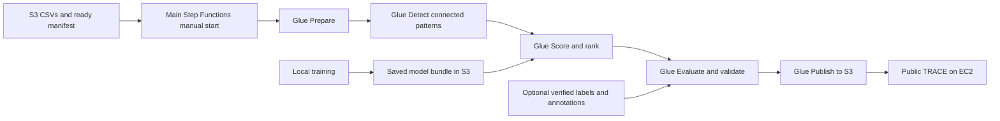

# IS459 TRACE submission index

Use this index with the final presentation. The project answers BQ1 with historical monitoring summaries and BQ2 with explainable connected-payment cases and an ML shortlist.

## Source and architecture on GitHub

1. [Business questions and data dictionary](Proposal/Project_Proposal.md). Include the objective, intended users, IBM HI-Medium source, field definitions, and known limits.
2. [Shared AWS architecture pack](Proposal/Architecture/Simplified/AWS_Architecture_Pack.pdf) and [editable source](Proposal/Architecture/Simplified/AWS_Architecture.drawio). These describe the shared pipeline, BQ1 monitoring, and rules-based BQ2. The [editable ML replay diagram](Proposal/Architecture/Simplified/ML_Replay_Architecture.drawio) records the historical replay. The current daily route is shown below.
3. [Ingestion](Implementation/deployment/upload_input.py), [ETL](Implementation/jobs/prepare.py), and [fresh BQ2 preparation](Implementation/ml_replay/glue/fresh_inputs.py). These cover source validation, identifiers, cleaning, account enrichment, and date partitions.
4. [BQ1 Spark analysis](Implementation/jobs/q1_risk.py) and [Athena SQL](Implementation/sql). Include the aggregation, counts, monitoring rates, lift, and catalog queries.
5. [BQ2 distributed detector](Implementation/jobs/q2_snapshots.py) and [graph rules](Implementation/jobs/q2_distributed.py). Include seven-day snapshots, fan patterns, bounded cycles, and retrievable payment evidence.
6. [ML training and feature code](Implementation/ml_replay/README.md#model-producers). The table links the five local fitting programs and identifies the inputs and evaluation periods. The [model bundle manifest](Implementation/ml_replay/model-bundle-manifest.json) identifies the exact fitted estimators and runtime assets used by Glue.
7. [ML scoring](Implementation/ml_replay/glue/score_batch.py) and [case ranking](Implementation/ml_replay/glue/rank_shortlist.py). Glue applies the frozen models to the facts and graph evidence for the supplied batch.
8. [Rules evaluation](Implementation/jobs/evaluate_distributed.py) and [ML evaluation and release validation](Implementation/ml_replay/glue/fresh_release.py). Include the baseline definition, label and annotation scope, payment metrics, pattern recovery, and evidence checks.
9. [Shared deployment](Implementation/deployment/full-maintained-stack.json), [daily route](Implementation/deployment/build_daily_bq2.py), [BQ2 Glue and workflow definitions](Implementation/deployment/build_fresh_bq2_stack.py), and [stage runner](Implementation/ml_replay/glue/fresh_glue.py). Include the EC2 [dashboard template](Implementation/deployment/build_public_dashboard.py) and [release reader](Implementation/dashboard/fresh_bq2.py).
10. [TRACE dashboard source](Implementation/dashboard/app.py). Include monitoring, connected cases, payment alerts, evaluation, and the original case evidence view.
11. [Setup](Implementation/SETUP.md), [runbook](Implementation/RUNBOOK.md), [batch input contract](Implementation/ml_replay/README.md#fresh-bq2-workflow), [pinned ML dependencies](Implementation/ml_replay/glue/glue-requirements.txt), and [tests](Implementation/tests). Include the sample-based tests and instructions for reproducing a batch with approved inputs.
12. [Validation and deployment status](Implementation/STATUS.md), [full-volume acceptance handoff](Implementation/team-handoffs/2026-11-10-0258Z-deshaun-full-volume-bq2.md), and [public TRACE handoff](Implementation/team-handoffs/2026-11-10-0647Z-deshaun-unify-trace-bq2.md). Include what ran, the evidence reviewed, and the remaining new-batch acceptance check.

## Current BQ2 batch path

Daily publication advances the BQ2 release. Monitoring and the published rules view read the separate historical release. The upload and schedule triggers are disabled. The earlier full-volume execution and the main-workflow smoke test passed. One newly uploaded batch remains to be verified through the current main route to public TRACE.

## eLearn and presentation appendix

13. **Final deck.** Upload the PDF or PPTX before the Week 13 lesson. Include the business questions, audience, objective, pipeline architecture, tools and packages, and a slide identifying each teammate's contribution.
14. **Pipeline setup video.** Upload the narrated or annotated end-to-end setup recording to YouTube and link it in the slides' appendix.
15. **Pipeline execution video.** Upload the narrated or annotated end-to-end execution recording to YouTube and link it in the appendix. Identify the version shown if the recording predates the current BQ2 route.
16. **Source files or repository link.** Attach the current source ZIP to eLearn or link the submitted Git revision in the appendix. Include the architecture export so the reviewer can open it without Draw.io.
17. **Fitted ML artifacts.** Attach the reviewed model bundle privately with the source submission. It contains `boosted_context.joblib`, `history_boost.joblib`, `hi_small.joblib`, `case-shape.joblib`, `evidence-progress.joblib`, category encodings, runtime metadata, the frozen ranking policy, the manifest, and Linux feature extractors. The repo tracks the fitting and inference code and the bundle checksums. The exact fitted weights are available from the project owner.
18. **Evaluation and demo evidence.** Include a compact results summary with population, payment precision and recall, eligible pattern recovery, and a screenshot or video showing TRACE. Label the full-history replay separately from the chronological holdout. Use the private submission channel for detailed run evidence and source payment examples.
19. **Data access and deployment links.** Link to the source datasets and the current public TRACE site from the appendix. Provide authorised data and model access instructions separately. Keep raw data, credentials, and private AWS records out of the public repository.
